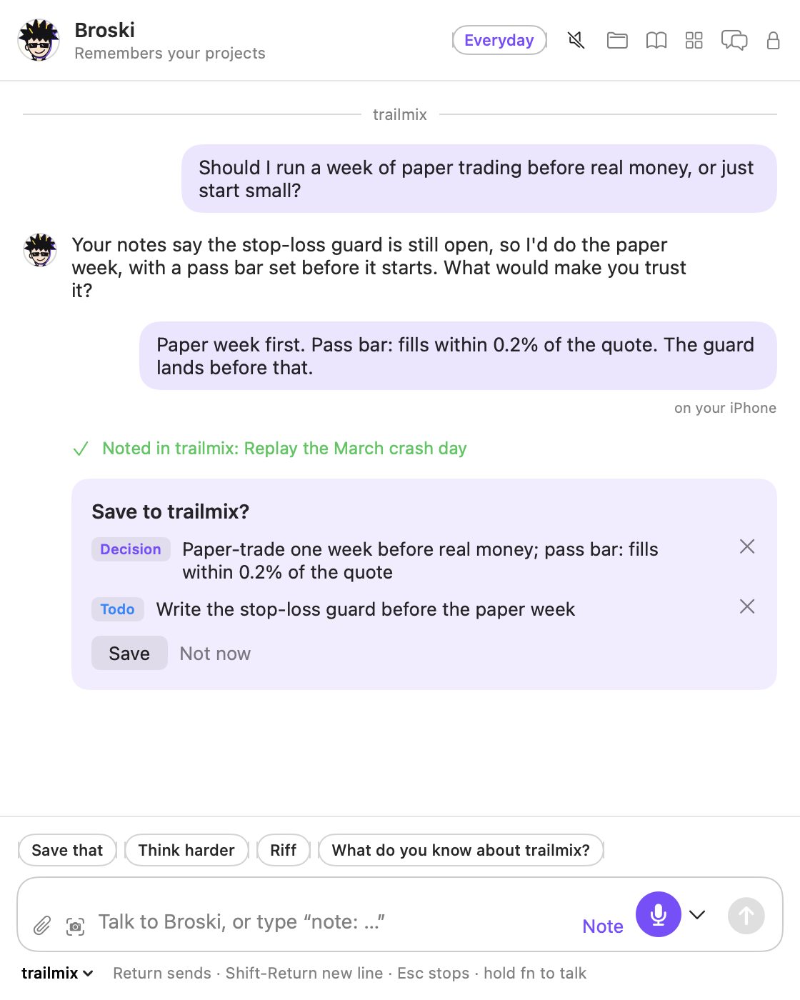

# Broski


Broski is a companion you talk to about your projects. Press **⌥⇧B** on your Mac and talk or type: Broski remembers what you've told it, thinks with you, and offers to save the decisions, todos and bugs you mention, saving only when you tap Save. Everything is plain files you own, any model can run it (Claude, OpenAI, Gemini and other providers, a model on your Mac, or Apple's on-device model), and an iPhone app shares the same conversation. Claude Code can read your notes through Broski's MCP server.

<p align="center">
  <picture>
    <source media="(prefers-color-scheme: dark)" srcset="site/assets/screens/dark/home.png">
    
  </picture>
</p>

## What it does

- **One conversation that remembers.** On the Mac and the iPhone, kept as plain files. Broski recalls your notes, older conversation and each project's decisions, and cites them ("on Oct 21 you decided…").
- **Nothing saved without you.** Decisions, todos and bugs come back as a save card. Quick notes (⌥⇧N), screenshot notes (⌥⇧S) and clips of highlighted text (⌥⇧C) are one key away.
- **Riff mode.** Brainstorm on the deep model by a set of rules and thinking moves, then wrap it up into one card.
- **Reads what you share.** Screenshots, photos, PDFs, and links, opened on your device.
- **A brain for every project.** A living page per project, a dashboard with a board, sessions that turn into reports, and each project's own tracker, read in place and never written to.
- **A companion that knows when to speak.** Ask Broski (⌥⇧A), Help with this (⌥⇧H), call notes, and nudges and a morning check-in that are off until you turn them on.
- **Private where you want it.** Local-only projects never reach a cloud model, private mode keeps nothing, and the private vault is encrypted with a passphrase only you know.
- **Voice on your Mac.** Bark (English) on the Neural Engine and Whisper (every language) turn speech into text on the device.

## Install

You need a Mac with Apple silicon on macOS 14 Sonoma or later.

1. Download the latest zip from [Releases](../../releases/latest). The release page lists its SHA-256 checksum.
2. Unzip it, drag **Broski** into **Applications**, and open it from there.
3. If macOS says it can't check Broski for malicious software: on macOS 15 or later, open System Settings › Privacy & Security and click **Open Anyway**; on macOS 14, right-click Broski and choose **Open**. You only do this once.

A short welcome sets up the shortcut, your voice, your AI and your project folders. [Getting started](docs/getting-started.md) covers the first run, permissions and voice models.

**Build from source** with Xcode 26 or later on macOS 15 or later. Clone the repository, then:

```bash
scripts/build-app.sh --open
```

## Choose your AI

Every feature asks for a role (fast, everyday or deep), and Settings › Models maps each role to a provider. Mix them as you like.

| Provider | What you need | Runs | Reads images |
|---|---|---|---|
| Claude (Anthropic) | An API key | Cloud | Yes, and PDFs |
| OpenAI | An API key | Cloud | Yes |
| Google Gemini | An API key (there's a free tier) | Cloud | Yes |
| OpenRouter | One API key for hundreds of models | Cloud | Yes |
| Groq | An API key | Cloud | No |
| Mistral | An API key | Cloud (Europe) | Yes |
| DeepSeek | An API key | Cloud | No |
| Ollama | Ollama on your Mac, no key | Your Mac | No, unless you mark the model |
| LM Studio | LM Studio's server on your Mac, no key | Your Mac | No, unless you mark the model |
| Apple on-device | macOS 26 or iOS 26 with Apple Intelligence | Your device | No |
| Another server | Any OpenAI-compatible address | Wherever it runs | If you mark it |

Broski tests the provider, reads its own list of models and picks one per role, which you can change. Keys stay on the device. Without any model, quick notes are still filed by Broski's built-in phrase rules. [Choosing your AI](docs/models.md) covers keys, costs, local models and spending.

## Privacy

Your notes, conversations and memory are files in your Broski folder: no account, no Broski server, no analytics. Text reaches a model only through one gateway that masks keys and tokens first. A local-only project's text goes only to models on your device, and with none set up Broski refuses rather than sending anything. Broski never sends audio anywhere itself. Read [Privacy](docs/privacy.md) for exactly what goes where, private mode, and how the vault is encrypted.

## The iPhone app

The same conversation, quick notes and your notes in your pocket, synced through iCloud Drive. It isn't in the App Store: you build it with your own Apple ID, and a free one works. See [The iPhone app](docs/iphone.md).

## Claude Code and MCP

`Broski --mcp` is an MCP server for Claude Code, Claude Desktop and other clients: projects, pages, search, decisions, trackers and what changed. It reads in place, hides local-only projects, and writes only to trackers Broski keeps. Settings › Connections connects Claude Code in one click. See [Claude Code and MCP](docs/mcp.md).

## Documentation

- [Getting started](docs/getting-started.md): install, first run, permissions, voice models, folders
- [Talking to Broski](docs/talking.md): what to say, riffs, quick notes, where notes go
- [Choosing your AI](docs/models.md): providers, roles, local-only rules, spending
- [Projects and trackers](docs/trackers.md): trackers read in place, onboarding a project
- [The iPhone app](docs/iphone.md) and [Claude Code and MCP](docs/mcp.md)
- [Privacy](docs/privacy.md) and [Troubleshooting](docs/troubleshooting.md)
- For contributors: [Architecture](docs/architecture.md), [Testing](docs/testing.md), [Releasing](docs/releasing.md)
- [Changelog](CHANGELOG.md) and [Support](SUPPORT.md)

## Contributing

Contributions are welcome. Broski is built test-first: write the failing test in `Tests/BroskiCoreTests`, then the code, and keep the logic in `BroskiCore`. Install the git hooks once with `scripts/install-hooks.sh`, and run `scripts/ci.sh` before you push. Coding agents start with [AGENTS.md](AGENTS.md). See [CONTRIBUTING.md](CONTRIBUTING.md), and the [code of conduct](CODE_OF_CONDUCT.md) everyone taking part follows.

## Security

Found a way to make Broski leak, act without asking, or read what it shouldn't? Please report it privately: see [SECURITY.md](SECURITY.md). The checklist for outside reviews is in [docs/SECURITY-REVIEW.md](docs/SECURITY-REVIEW.md).

## License

Apache License 2.0: see [LICENSE](LICENSE). Third-party credits are in [NOTICE](NOTICE).

## Credits

Speech recognition: [Underdog Bark 3.0](https://huggingface.co/ConwayResearch/Underdog-Bark-3.0) by Conway Research (CC BY 4.0), built on NVIDIA's parakeet-tdt-0.6b-v3 (CC BY 4.0). Whisper via [whisper.cpp](https://github.com/ggml-org/whisper.cpp) (MIT). The design owes ideas to OpenClaw, VoiceInk and FluidVoice; [Architecture](docs/architecture.md#prior-art) says which.
